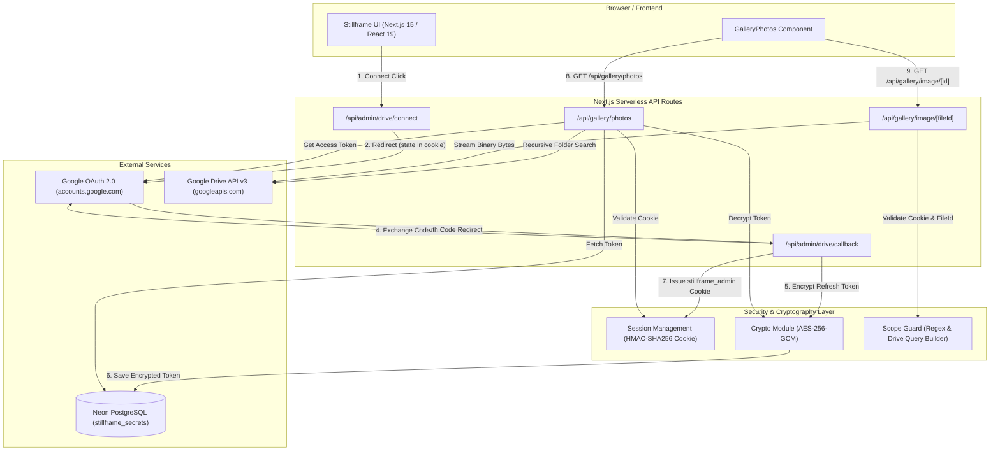

# System Architecture — Stillframe Gallery

## 1. Architectural Overview

Stillframe is built on Next.js 15 (App Router) on Node.js serverless runtimes, backed by a single Google Drive folder and Neon PostgreSQL for encrypted token persistence.



---

## 2. Component Breakdown

### A. Frontend Layer
- **Framework**: Next.js 15.5.29, React 19.1.0, Tailwind CSS v4, Lucide React icons.
- **Entry Point**: `app/page.tsx` renders the dark cinematic landing layout and embeds `<GalleryPhotos />` (`components/gallery-photos.tsx`).
- **Data Flow**:
  - Checks `/api/gallery/photos`.
  - If 401 Unauthorized, displays administrator "Connect Google Drive" banner pointing to `/api/admin/drive/connect`.
  - If 200 OK, renders a responsive 3-column photo grid (`.photo-tile`) linking to `/api/gallery/image/[fileId]`.

### B. OAuth & Identity Flow
- **Initiation (`/api/admin/drive/connect`)**:
  - Generates 32-byte cryptographic random state.
  - Stores state in `stillframe_oauth_state` (httpOnly, sameSite=lax, maxAge=600).
  - Redirects to Google OAuth with scopes: `openid email https://www.googleapis.com/auth/drive.readonly`.
  - Enforces `access_type=offline`, `prompt=consent select_account`.
- **Callback (`/api/admin/drive/callback`)**:
  - Compares callback state with `stillframe_oauth_state` via `crypto.timingSafeEqual`.
  - Exchanges authorization code for tokens via Google OAuth token endpoint.
  - Fetches user info from `https://www.googleapis.com/oauth2/v2/userinfo`.
  - **Account Restriction**: Verifies `user.verified_email` is true and `user.email.toLowerCase() === ADMIN_EMAIL.toLowerCase()`.
  - Encrypts `refresh_token` using AES-256-GCM with key derived from `TOKEN_ENCRYPTION_KEY`.
  - Persists ciphertext in PostgreSQL table `stillframe_secrets`.
  - Issues signed session cookie `stillframe_admin` (HMAC-SHA256, 7-day TTL).

### C. Database & Token Store (`lib/drive/store.ts` & `lib/drive/crypto.ts`)
- **Driver**: `postgres` (PGLite / Neon compatible).
- **Configuration**: `ssl: 'require'`, `max: 1`, `prepare: false` (optimal for serverless transaction poolers).
- **Schema**: Single table `stillframe_secrets`:
  ```sql
  CREATE TABLE IF NOT EXISTS stillframe_secrets (
    key text PRIMARY KEY,
    value text NOT NULL,
    updated_at timestamptz NOT NULL DEFAULT now()
  );
  ```
- **Encryption**: AES-256-GCM.
  - Format: `base64url(iv).base64url(tag).base64url(ciphertext)`.
  - Key: SHA-256 digest of `TOKEN_ENCRYPTION_KEY`.

### D. Drive Integration & Folder Scoping (`lib/drive/google.ts` & `lib/drive/scope.ts`)
- **Root Folder Isolation**: `GOOGLE_DRIVE_ROOT_FOLDER_ID` is strictly read from environment variables; client parameters cannot supply an alternate folder.
- **Traversal Algorithm**:
  - Breadth-first search starting from `rootFolderId`.
  - Guarded against cycles and runaway traversal with a hard limit of `seen.size < 500`.
  - Paginated Drive v3 queries (`pageSize: 100`, `fields: 'nextPageToken,files(id,name,mimeType,size,modifiedTime,thumbnailLink,parents)'`).
  - Separates child folders (`mimeType === 'application/vnd.google-apps.folder'`) from images.
  - Filters images using regex whitelist: `image/(jpeg|png|webp|gif|heic|heif|avif|bmp|tiff?)`.

### E. Authenticated Image Proxy (`/api/gallery/image/[fileId]`)
- Requires valid `stillframe_admin` session.
- Validates file ID syntax against regex `^[a-zA-Z0-9_-]{10,}$` (prevents path injection / malformed requests).
- Verifies the requested file ID exists within the permitted traversal scope of `rootFolderId`.
- Streams raw binary data with headers:
  - `Content-Type: <mimeType>`
  - `Cache-Control: private, no-store`
  - `X-Content-Type-Options: nosniff`
  - `Content-Disposition: inline`
